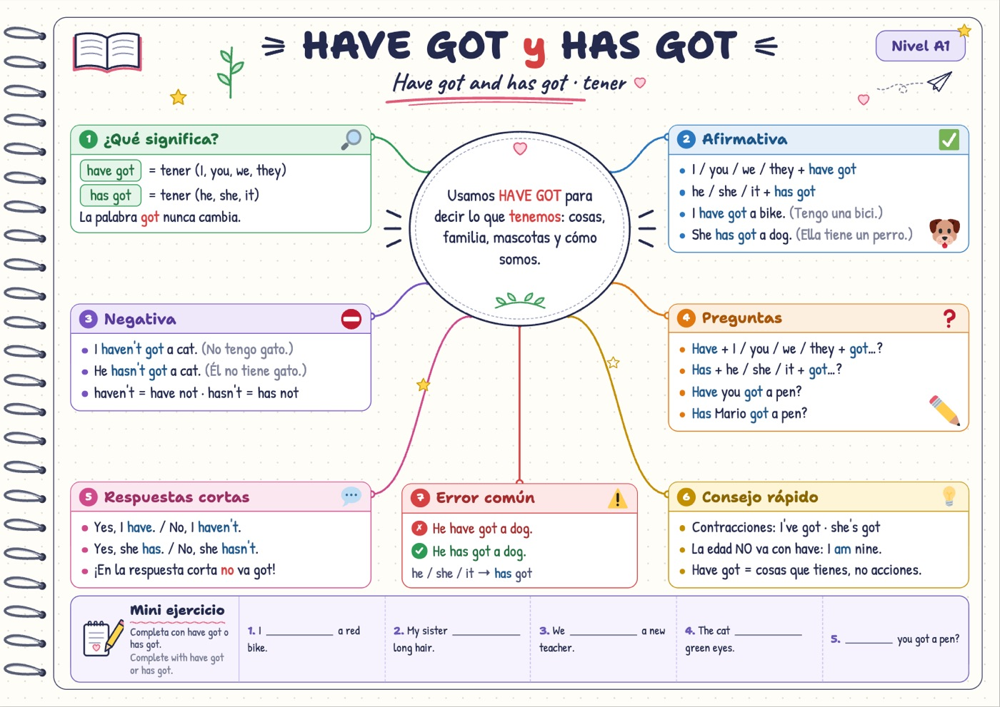
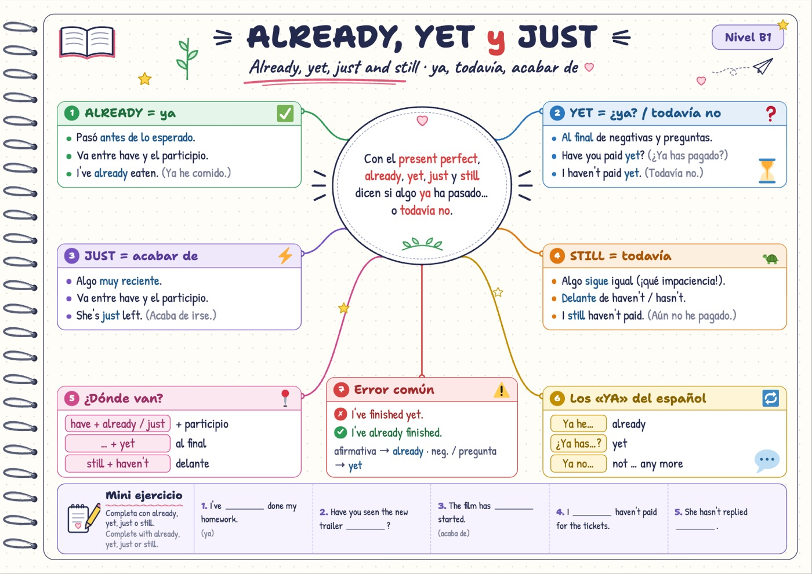
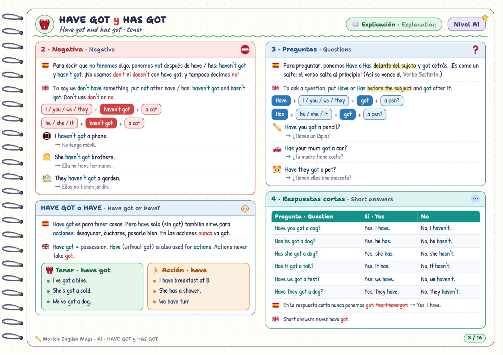
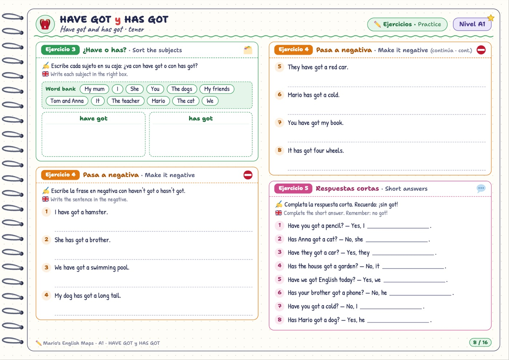
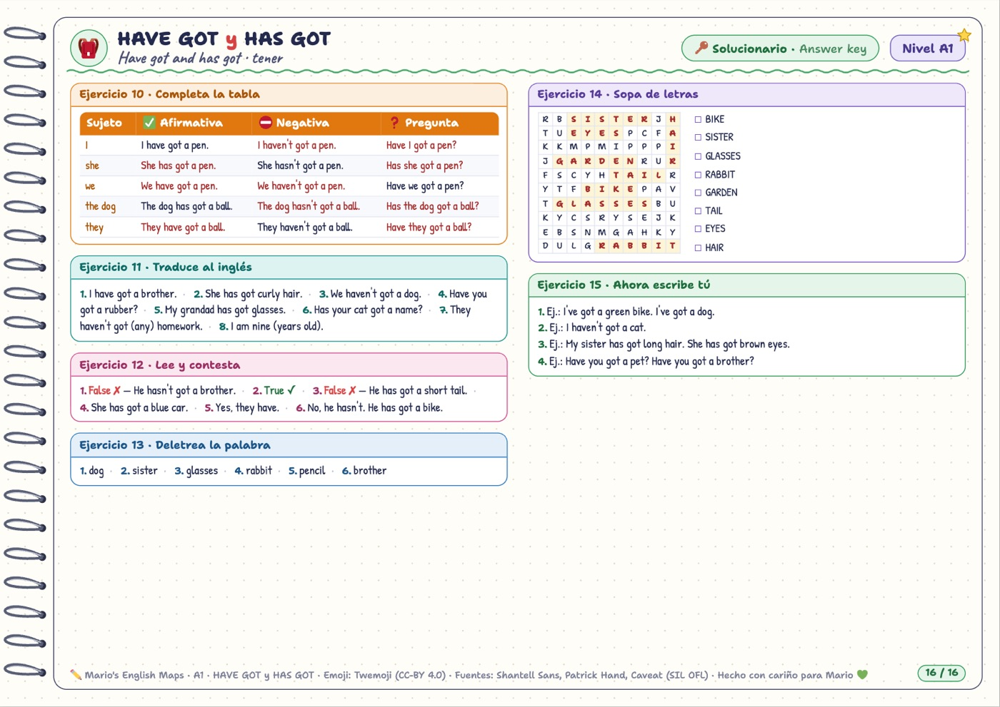

<div align="center">

# 🗺️ English all levels · *Mario's English Maps*

### Mapas mentales de gramática inglesa en PDF, del **A1** al **C2**, explicados en español e inglés, con cientos de ejercicios y su solucionario.

**Gratis y de código abierto. Para imprimir, estudiar, compartir y adaptar.**




</div>

---

## 📌 Índice

1. [¿Qué es esto?](#-qué-es-esto)
2. [Qué incluye, en números](#-qué-incluye-en-números)
3. [Descargar los PDF](#-descargar-los-pdf)
4. [Los niveles (MCER) y a quién van dirigidos](#-los-niveles-mcer-y-a-quién-van-dirigidos)
5. [Todos los mapas, nivel a nivel](#-todos-los-mapas-nivel-a-nivel)
6. [Cómo es cada PDF por dentro](#-cómo-es-cada-pdf-por-dentro)
7. [Tipos de ejercicios](#-tipos-de-ejercicios)
8. [Los monstruos de los errores](#-los-monstruos-de-los-errores)
9. [Cómo usarlos: guía para familias y profes](#-cómo-usarlos-guía-para-familias-y-profes)
10. [Cómo imprimirlos](#️-cómo-imprimirlos)
11. [Para desarrolladores: generar los PDF](#️-para-desarrolladores-generar-los-pdf)
12. [Crear o editar un mapa](#️-crear-o-editar-un-mapa)
13. [Cómo funciona el motor por dentro](#-cómo-funciona-el-motor-por-dentro)
14. [Contribuir](#-contribuir)
15. [Licencia](#️-licencia)
16. [Créditos y agradecimientos](#-créditos-y-agradecimientos)

---

## 💡 ¿Qué es esto?

**English all levels** es una colección de **65 fichas de gramática inglesa**, una por concepto ("el verbo *to be*", "*have got*", "el *present perfect*", "la inversión"…), que cubren **todo el Marco Común Europeo de Referencia, del A1 al C2**.

Cada ficha es un **PDF a color en A4 apaisado** con aspecto de cuaderno de espiral, y empieza con un **mapa mental** que resume el concepto de un vistazo. Después vienen una **explicación completa en español** (con su versión en inglés), muchos **ejemplos traducidos**, entre 13 y 16 **ejercicios** de dificultad creciente y un **solucionario**.

Nació para **Mario**, un niño de 8 años de un colegio bilingüe que habla inglés con soltura pero comete al escribir los errores típicos de quien piensa en español (*"I have 10 years"*, *"She is no home"*, *"You are happy?"*). Es el complemento en papel de su app **[Mario vs. the Word Monsters](https://github.com/oskarko/mario-vs-word-monsters)**: los errores típicos aparecen aquí con los mismos **monstruos** que en la app.

Lo publicamos para que **cualquier familia, profe, academia o estudiante** pueda usarlo gratis.

> **¿Para quién es?**
> - 👧 **Niños y niñas de Primaria** (A1-A2): ejemplos de su mundo (el cole, la familia, las mascotas, el fútbol) y explicaciones sencillas.
> - 🧑‍🎓 **Adolescentes y adultos** (B1-B2): situaciones reales (viajes, trabajo, series, estudios) y preparación de exámenes tipo Cambridge *PET* y *First*.
> - 👩‍💼 **Nivel avanzado** (C1-C2): registro formal y académico, matices y transformaciones tipo *Advanced* y *Proficiency*.
> - 👩‍🏫 **Profesores y academias**: material listo para fotocopiar, con solucionario, y editable si quieres adaptarlo.

---

## 📊 Qué incluye, en números

| | |
|---|---|
| 🗺️ **Mapas (conceptos)** | **65**, cada uno en su propio PDF |
| 🎓 **Niveles** | **6**: A1, A2, B1, B2, C1 y C2 |
| 📄 **Páginas** | **1.224** (de 16 a 26 por mapa) |
| ✏️ **Ejercicios** | **996** (13-16 por mapa) |
| ❓ **Preguntas para resolver** | **8.684**, todas con su respuesta en el solucionario |
| 💬 **Frases de ejemplo traducidas** | **1.840** |
| 📚 **Libros por nivel** | **6** (portada + índice + todos los mapas del nivel en un único PDF) |
| 🌍 **Idiomas de la explicación** | 🇪🇸 español (principal) + 🇬🇧 inglés |

---

## 📥 Descargar los PDF

Hay dos formas de descargarlos:

### Opción 1 · Un PDF por concepto (recomendada para empezar)

Están en la carpeta [`pdf/`](pdf/), ordenados por nivel. En la [tabla de abajo](#-todos-los-mapas-nivel-a-nivel) tienes el enlace directo a cada uno. Para bajarlo: abre el enlace y pulsa el botón **⬇️ Download raw file** (arriba a la derecha del visor de GitHub).

### Opción 2 · El libro completo de cada nivel

Todos los mapas de un nivel en un solo PDF, con **portada, índice con números de página y guía de uso**. Por su tamaño están en la sección **[Releases](https://github.com/oskarko/English-all-levels/releases/latest)**:

| Nivel | Libro completo | Páginas |
|:-:|---|:-:|
| 🟢 **A1** | [⬇️ Nivel-A1-libro-completo.pdf](https://github.com/oskarko/English-all-levels/releases/latest/download/Nivel-A1-libro-completo.pdf) | 290 |
| 🔵 **A2** | [⬇️ Nivel-A2-libro-completo.pdf](https://github.com/oskarko/English-all-levels/releases/latest/download/Nivel-A2-libro-completo.pdf) | 257 |
| 🟠 **B1** | [⬇️ Nivel-B1-libro-completo.pdf](https://github.com/oskarko/English-all-levels/releases/latest/download/Nivel-B1-libro-completo.pdf) | 224 |
| 🟣 **B2** | [⬇️ Nivel-B2-libro-completo.pdf](https://github.com/oskarko/English-all-levels/releases/latest/download/Nivel-B2-libro-completo.pdf) | 195 |
| 🔴 **C1** | [⬇️ Nivel-C1-libro-completo.pdf](https://github.com/oskarko/English-all-levels/releases/latest/download/Nivel-C1-libro-completo.pdf) | 153 |
| 🩵 **C2** | [⬇️ Nivel-C2-libro-completo.pdf](https://github.com/oskarko/English-all-levels/releases/latest/download/Nivel-C2-libro-completo.pdf) | 121 |

> 💾 **¿Lo quieres todo de golpe?** Pulsa el botón verde **`<> Code` → `Download ZIP`** en la parte superior de esta página y tendrás todos los PDF por concepto (unos 140 MB).

---

## 🎓 Los niveles (MCER) y a quién van dirigidos

El **MCER** (*Marco Común Europeo de Referencia para las lenguas*) divide el aprendizaje de un idioma en seis niveles. Cada nivel tiene su **color** en los PDF (la insignia "Nivel A1" de arriba a la derecha y los detalles de las páginas).

| Nivel | Color | Qué significa | Equivale a (Cambridge) | Público de estos mapas |
|:-:|:-:|---|---|---|
| **A1** | 🟢 verde | **Acceso**: frases básicas sobre uno mismo y el entorno inmediato. | *Pre A1 Starters*, *A1 Movers* | Niños de Primaria (Mario, 8 años) |
| **A2** | 🔵 azul | **Plataforma**: describir el pasado, comparar, planes, compras. | *A2 Flyers*, *A2 Key (KET)* | Niños de 9-11 años, principiantes |
| **B1** | 🟠 naranja | **Umbral**: desenvolverse en viajes, contar experiencias, dar opiniones. | *B1 Preliminary (PET)* | Adolescentes y adultos |
| **B2** | 🟣 morado | **Avanzado**: argumentar, matizar, entender textos complejos. | *B2 First (FCE)* | Adolescentes mayores y adultos |
| **C1** | 🔴 rojo | **Dominio operativo eficaz**: registro formal, estructuras enfáticas. | *C1 Advanced (CAE)* | Adultos, nivel universitario o profesional |
| **C2** | 🩵 turquesa | **Maestría**: precisión, estilo, matices casi nativos. | *C2 Proficiency (CPE)* | Adultos de nivel muy alto |

> 🧭 **¿Por dónde empiezo?** Si no sabes tu nivel, abre el mapa (primera página) de un concepto de cada nivel. Si lo entiendes casi todo y aciertas el *Mini ejercicio*, ese nivel ya lo tienes: pasa al siguiente. Dentro de cada nivel, **los mapas están numerados en el orden recomendado de estudio**.

---

## 🗂️ Todos los mapas, nivel a nivel

La columna **"De qué trata"** es el subtítulo del mapa: en inglés y, tras el punto, una pista en español.

### 🟢 Nivel A1 · Acceso · *Beginner* (17 mapas · 287 páginas)
Para quien empieza de cero o para los más pequeños: el alfabeto, *to be*, *have got*, el presente, plurales, artículos, posesivos, *there is*, *can*, preposiciones, adjetivos, números y la hora.

| | Mapa | De qué trata | Págs. | PDF |
|---|---|---|:-:|:-:|
| 🔤 | **A1-01 · El alfabeto** | The alphabet · las letras en inglés | 18 | [📄 PDF](pdf/A1/A1-01-alphabet.pdf) |
| 😊 | **A1-02 · El verbo to be** | Am, is, are · ser y estar | 16 | [📄 PDF](pdf/A1/A1-02-to-be.pdf) |
| 🎒 | **A1-03 · Have got y has got** | Have got and has got · tener | 16 | [📄 PDF](pdf/A1/A1-03-have-got.pdf) |
| ⏰ | **A1-04 · Present simple** | Present simple · rutinas y la -s | 17 | [📄 PDF](pdf/A1/A1-04-present-simple.pdf) |
| ❓ | **A1-05 · Do y does** | Do and does · negativas y preguntas | 16 | [📄 PDF](pdf/A1/A1-05-do-does.pdf) |
| 🔁 | **A1-06 · Adverbios de frecuencia** | Adverbs of frequency · ¿con qué frecuencia? | 16 | [📄 PDF](pdf/A1/A1-06-frequency-adverbs.pdf) |
| 🐑 | **A1-07 · Los plurales** | Plurals · uno, dos, muchos | 19 | [📄 PDF](pdf/A1/A1-07-plurals.pdf) |
| 🍎 | **A1-08 · A, an y the** | Articles · un, una, el, la, los, las | 18 | [📄 PDF](pdf/A1/A1-08-articles.pdf) |
| 👉 | **A1-09 · This, that, these, those** | Demonstratives · este, ese, estos, esos | 17 | [📄 PDF](pdf/A1/A1-09-this-that.pdf) |
| 🏷️ | **A1-10 · My, your… y 's** | Possessives · mi, tu, su… y el 's | 18 | [📄 PDF](pdf/A1/A1-10-possessives.pdf) |
| 🏡 | **A1-11 · There is y there are** | There is / there are · hay | 17 | [📄 PDF](pdf/A1/A1-11-there-is-are.pdf) |
| 💪 | **A1-12 · Can y can't** | Can and can't · saber hacer, poder | 16 | [📄 PDF](pdf/A1/A1-12-can.pdf) |
| 📦 | **A1-13 · Preposiciones de lugar** | Prepositions of place · ¿dónde está? | 17 | [📄 PDF](pdf/A1/A1-13-prepositions-place.pdf) |
| 🎬 | **A1-14 · Present continuous** | Present continuous · lo que pasa ahora | 17 | [📄 PDF](pdf/A1/A1-14-present-continuous.pdf) |
| 🕵️ | **A1-15 · What, where, who** | Question words · palabras para preguntar | 16 | [📄 PDF](pdf/A1/A1-15-question-words.pdf) |
| 🎨 | **A1-16 · Los adjetivos** | Adjectives · cómo son las cosas | 16 | [📄 PDF](pdf/A1/A1-16-adjectives.pdf) |
| ⏰ | **A1-17 · Números y la hora** | Numbers, dates and time · números, fechas y la hora | 17 | [📄 PDF](pdf/A1/A1-17-numbers-time.pdf) |


### 🔵 Nivel A2 · Plataforma · *Elementary* (14 mapas · 254 páginas)
El pasado (regular, irregular, *was/were*, *did*), comparar, cuantificar, el futuro con *going to*, obligaciones, adverbios, pronombres y las compras.

| | Mapa | De qué trata | Págs. | PDF |
|---|---|---|:-:|:-:|
| ⏳ | **A2-01 · Was y were** | Was and were · el pasado de to be | 18 | [📄 PDF](pdf/A2/A2-01-was-were.pdf) |
| ⏪ | **A2-02 · Pasado regular (-ed)** | Regular past simple · verbos con -ed | 19 | [📄 PDF](pdf/A2/A2-02-past-regular.pdf) |
| ⚡ | **A2-03 · Verbos irregulares** | Irregular verbs · el pasado sin -ed | 18 | [📄 PDF](pdf/A2/A2-03-past-irregular.pdf) |
| 🕵️ | **A2-04 · Did y didn't** | Did and didn't · negativas y preguntas en pasado | 17 | [📄 PDF](pdf/A2/A2-04-did-didnt.pdf) |
| ⚖️ | **A2-05 · Comparativos** | Comparatives · comparar dos cosas | 19 | [📄 PDF](pdf/A2/A2-05-comparatives.pdf) |
| 🏆 | **A2-06 · Superlativos** | Superlatives · el más…, el mejor, el peor | 19 | [📄 PDF](pdf/A2/A2-06-superlatives.pdf) |
| 📅 | **A2-07 · In, on y at (tiempo)** | Prepositions of time · ¿cuándo pasa? | 19 | [📄 PDF](pdf/A2/A2-07-prepositions-time.pdf) |
| 🛒 | **A2-08 · Some, any, much, many** | Countable and uncountable · cantidades | 19 | [📄 PDF](pdf/A2/A2-08-some-any-much-many.pdf) |
| 🔮 | **A2-09 · Going to** | Be going to · planes y predicciones | 19 | [📄 PDF](pdf/A2/A2-09-going-to.pdf) |
| 🔄 | **A2-10 · Simple vs continuous** | Present simple and present continuous · siempre o ahora | 17 | [📄 PDF](pdf/A2/A2-10-present-simple-vs-continuous.pdf) |
| 🚦 | **A2-11 · Must y have to** | Must and have to · obligación y prohibición | 19 | [📄 PDF](pdf/A2/A2-11-must-have-to.pdf) |
| 🏃 | **A2-12 · Adverbios de modo** | Adverbs of manner · cómo hacemos las cosas | 17 | [📄 PDF](pdf/A2/A2-12-adverbs-manner.pdf) |
| 🎁 | **A2-13 · Me, him y mine** | Object and possessive pronouns · pronombres | 17 | [📄 PDF](pdf/A2/A2-13-object-possessive-pronouns.pdf) |
| 🛍️ | **A2-14 · Precios y dinero** | Shopping and money · de compras | 17 | [📄 PDF](pdf/A2/A2-14-shopping-money.pdf) |


### 🟠 Nivel B1 · Umbral · *Intermediate* (12 mapas · 221 páginas)
El *present perfect* en todas sus caras, el pasado continuo, los futuros, el primer y el segundo condicional, las oraciones de relativo, *used to*, gerundio o infinitivo y la pasiva.

| | Mapa | De qué trata | Págs. | PDF |
|---|---|---|:-:|:-:|
| 🌍 | **B1-01 · Present perfect (experiencias)** | Present perfect · experiencias de la vida | 20 | [📄 PDF](pdf/B1/B1-01-present-perfect-experiences.pdf) |
| ⏳ | **B1-02 · Already, yet y just** | Already, yet, just and still · ya, todavía, acabar de | 19 | [📄 PDF](pdf/B1/B1-02-already-yet-just.pdf) |
| ⏱️ | **B1-03 · For y since** | For and since · How long…? · desde / desde hace | 18 | [📄 PDF](pdf/B1/B1-03-for-since.pdf) |
| ⚖️ | **B1-04 · Present perfect o past simple** | Present perfect vs past simple · ¿he ido o fui? | 18 | [📄 PDF](pdf/B1/B1-04-perfect-vs-past.pdf) |
| 🎬 | **B1-05 · Past continuous** | Past continuous · estaba haciendo | 18 | [📄 PDF](pdf/B1/B1-05-past-continuous.pdf) |
| 🔮 | **B1-06 · Will o going to** | Will, going to and present continuous · el futuro | 18 | [📄 PDF](pdf/B1/B1-06-future-forms.pdf) |
| ☔ | **B1-07 · First conditional** | First conditional · si pasa esto, pasará aquello | 20 | [📄 PDF](pdf/B1/B1-07-first-conditional.pdf) |
| 💭 | **B1-08 · Second conditional** | Second conditional · situaciones imaginarias | 19 | [📄 PDF](pdf/B1/B1-08-second-conditional.pdf) |
| 🔗 | **B1-09 · Relative clauses** | Relative clauses · who, which, that, where, whose | 18 | [📄 PDF](pdf/B1/B1-09-relative-clauses.pdf) |
| 📼 | **B1-10 · Used to** | Used to · antes solía…, antes hacía… | 17 | [📄 PDF](pdf/B1/B1-10-used-to.pdf) |
| 🎯 | **B1-11 · Gerundio o infinitivo** | Verb + -ing or verb + to · ¿doing o to do? | 17 | [📄 PDF](pdf/B1/B1-11-gerund-infinitive.pdf) |
| 🏗️ | **B1-12 · Voz pasiva (básica)** | The passive · present and past simple | 19 | [📄 PDF](pdf/B1/B1-12-passive-basic.pdf) |


### 🟣 Nivel B2 · Avanzado · *Upper-intermediate* (10 mapas · 192 páginas)
El tercer condicional, el estilo indirecto, la pasiva avanzada, los tiempos perfectos, los modales de deducción, *wish*, los *phrasal verbs* y los conectores.

| | Mapa | De qué trata | Págs. | PDF |
|---|---|---|:-:|:-:|
| ⏪ | **B2-01 · Third conditional** | Third conditional · el pasado que no fue | 20 | [📄 PDF](pdf/B2/B2-01-third-conditional.pdf) |
| 🗣️ | **B2-02 · Estilo indirecto** | Reported statements · contar lo que alguien dijo | 20 | [📄 PDF](pdf/B2/B2-02-reported-statements.pdf) |
| 📣 | **B2-03 · Preguntas y órdenes indirectas** | Reported questions & commands · estilo indirecto | 21 | [📄 PDF](pdf/B2/B2-03-reported-questions.pdf) |
| 🏗️ | **B2-04 · Voz pasiva avanzada** | Advanced passive · todos los tiempos | 20 | [📄 PDF](pdf/B2/B2-04-passive-advanced.pdf) |
| 🕰️ | **B2-05 · Past perfect** | Simple & continuous · el pasado del pasado | 19 | [📄 PDF](pdf/B2/B2-05-past-perfect.pdf) |
| ⏳ | **B2-06 · Present perfect continuous** | Present perfect continuous · llevo + tiempo + -ando | 19 | [📄 PDF](pdf/B2/B2-06-present-perfect-continuous.pdf) |
| 🕵️ | **B2-07 · Modales de deducción** | Modals of deduction · must, might, can't | 17 | [📄 PDF](pdf/B2/B2-07-modals-deduction.pdf) |
| 🌠 | **B2-08 · Wish e if only** | Wish and if only · deseos y lamentos | 18 | [📄 PDF](pdf/B2/B2-08-wish-if-only.pdf) |
| 🧩 | **B2-09 · Phrasal verbs** | Phrasal verbs · verbos con partícula | 19 | [📄 PDF](pdf/B2/B2-09-phrasal-verbs.pdf) |
| 🔗 | **B2-10 · Conectores** | Linkers · although, despite, however… | 19 | [📄 PDF](pdf/B2/B2-10-linkers.pdf) |


### 🔴 Nivel C1 · Dominio operativo · *Advanced* (7 mapas · 151 páginas)
Inversión, *cleft sentences*, condicionales avanzadas, *participle clauses*, futuro avanzado, modales en pasado y el *unreal past*.

| | Mapa | De qué trata | Págs. | PDF |
|---|---|---|:-:|:-:|
| 🔄 | **C1-01 · Inversión avanzada** | Advanced inversion · énfasis y registro formal | 23 | [📄 PDF](pdf/C1/C1-01-inversion.pdf) |
| ✂️ | **C1-02 · Cleft sentences** | Cleft sentences · frases escindidas para dar énfasis | 21 | [📄 PDF](pdf/C1/C1-02-cleft-sentences.pdf) |
| 🔀 | **C1-03 · Condicionales avanzadas** | Advanced conditionals · mixtas y alternativas a if | 23 | [📄 PDF](pdf/C1/C1-03-advanced-conditionals.pdf) |
| 🔗 | **C1-04 · Participle clauses** | Participle clauses · oraciones de participio | 21 | [📄 PDF](pdf/C1/C1-04-participle-clauses.pdf) |
| ⏳ | **C1-05 · Futuro avanzado** | Future continuous, future perfect & more · el futuro con matices | 22 | [📄 PDF](pdf/C1/C1-05-future-advanced.pdf) |
| 🕰️ | **C1-06 · Modales en pasado** | Past modals · crítica, arrepentimiento y especulación | 21 | [📄 PDF](pdf/C1/C1-06-past-modals.pdf) |
| 🎭 | **C1-07 · Unreal past** | Would rather, it's time, as if · el pasado que no es pasado | 20 | [📄 PDF](pdf/C1/C1-07-unreal-past.pdf) |


### 🩵 Nivel C2 · Maestría · *Proficiency* (5 mapas · 119 páginas)
Subjuntivo y estructuras formales, elipsis y sustitución, matizar y enfatizar, *idioms* y nominalización con estilo académico.

| | Mapa | De qué trata | Págs. | PDF |
|---|---|---|:-:|:-:|
| 🎩 | **C2-01 · El subjuntivo y estructuras formales** | The subjunctive · estructuras formales | 23 | [📄 PDF](pdf/C2/C2-01-subjunctive.pdf) |
| ✂️ | **C2-02 · Elipsis y sustitución** | Ellipsis and substitution · decir más con menos | 23 | [📄 PDF](pdf/C2/C2-02-ellipsis-substitution.pdf) |
| 🎚️ | **C2-03 · Matizar y enfatizar** | Hedging and emphasis · suavizar y reforzar | 22 | [📄 PDF](pdf/C2/C2-03-hedging-emphasis.pdf) |
| 🐘 | **C2-04 · Idioms y expresiones** | Idioms and fixed expressions · modismos | 26 | [📄 PDF](pdf/C2/C2-04-idioms.pdf) |
| 🎓 | **C2-05 · Nominalización y estilo académico** | Nominalisation · estilo académico | 25 | [📄 PDF](pdf/C2/C2-05-nominalisation.pdf) |


> 📋 El **alcance exacto** de cada mapa (qué entra y qué se deja para otro) está en [`CURRICULUM.md`](CURRICULUM.md).

---

## 🔍 Cómo es cada PDF por dentro

Todos los PDF siguen la misma estructura. Una vez conoces uno, los conoces todos.

### 1️⃣ El mapa mental (página 1)



Es la página estrella: **todo el concepto en una sola hoja**, pensada para pegarla en la pared o guardarla en la carpeta y repasarla de un vistazo.

| Parte del mapa | Qué es |
|---|---|
| **Título grande** | El concepto, en mayúsculas ("ALREADY, YET y JUST"). Debajo, el subtítulo en inglés con una pista en español. |
| **Insignia de nivel** (arriba a la derecha) | "Nivel B1", con el color de su nivel. |
| **Óvalo central** | La **idea clave** en una o dos frases. Si solo te acuerdas de una cosa, que sea esta. |
| **6 cajas numeradas** | Las partes del concepto en el orden de lectura (1 arriba a la izquierda, 2 arriba a la derecha, 3 en medio a la izquierda…): cómo se forma, afirmativa, negativa, preguntas, palabras clave, consejos… Cada una con su color y su icono. |
| **Error común** (caja roja central) | El fallo más típico de un hispanohablante, ❌ mal frente a ✅ bien, y por qué. |
| **Mini ejercicio** (franja de abajo) | 5 huecos rápidos para comprobar que lo has entendido. Las respuestas están en el solucionario. |

### 2️⃣ La explicación (unas 4-7 páginas)



Bloques de colores a dos columnas. Cada regla se explica **primero en español 🇪🇸** (la explicación principal) y **después en inglés 🇬🇧** (más breve, para ir acostumbrando el oído). Tipos de bloque que encontrarás:

| Bloque | Qué contiene |
|---|---|
| 🔎 **¿Qué es?** | Presentación del concepto y su fórmula. |
| 📐 **Reglas numeradas** (1 · Afirmativa, 2 · Negativa…) | Explicación, **fórmula con fichas de colores** (*Sujeto + has got + objeto*) y 3 ejemplos traducidos. |
| 📋 **Tablas** | Conjugaciones completas, listas de verbos, cuadros resumen ("Todo junto"). |
| 🧩 **Vocabulario** | Palabras útiles con su ilustración y traducción. |
| ⚖️ **Comparaciones** | Dos cosas que se confunden, lado a lado (*have got* frente a *have*, *for* frente a *since*…). |
| 💬 **Más ejemplos** | De 8 a 14 frases con su traducción. |
| 👾 **¡Caza al monstruo!** | De 5 a 8 errores típicos: ❌ la frase mal, ✅ la frase bien y el **porqué**. |
| 🪜 **Paso a paso** | "¿Cómo construyo la frase?": el razonamiento en pasos. |
| 🗨️ **Diálogo** | Una conversación realista con traducción. |
| 💡 **Truco** | Un truco para recordarlo. |

### 3️⃣ Los ejercicios (unas 6-9 páginas)



Empiezan con una línea para **nombre, fecha y puntuación**. Cada ejercicio indica qué hay que hacer en español ✍️ y en inglés 🇬🇧, y van **de fácil a difícil**: primero reconocer, luego completar, transformar, corregir y, al final, producir (traducir, leer y escribir). Más abajo tienes la [lista de tipos de ejercicio](#-tipos-de-ejercicios).

### 4️⃣ El repaso: *¿Lo he aprendido?* (1 página)

Una lista de **"Lo sé hacer"** (*I can…*) para marcar y una tabla de **progreso con estrellas** (☆☆☆) para colorear en cada ejercicio. Así el alumno se autoevalúa y ve su avance.

### 5️⃣ El solucionario (1-3 páginas)



**Todas las respuestas**: las del *Mini ejercicio* del mapa y las de cada ejercicio, con el mismo número. Las tablas aparecen rellenas, la sopa de letras resuelta y, cuando hay más de una respuesta válida, se indican todas. En la escritura libre se da un modelo de ejemplo.

> ✂️ **Consejo:** si el PDF es para un niño, imprime el solucionario aparte (son las últimas páginas) y guárdalo tú.

---

## ✏️ Tipos de ejercicios

| Tipo | Cómo es | Qué entrena |
|---|---|---|
| ⭕ **Rodea la correcta** | *She ( have / has ) got a cat.* | Reconocer la forma correcta |
| 🔗 **Une** | Dos columnas para unir con flechas | Relacionar pregunta y respuesta, palabra y significado |
| 🗂️ **Clasifica** | Palabras para colocar en 2-4 cajas | Distinguir categorías (*have* / *has*, contable / incontable…) |
| 📝 **Completa** | Frases con huecos y, a veces, un banco de palabras | Aplicar la regla |
| 📋 **Completa la tabla** | Una tabla con casillas vacías | Ver el sistema completo |
| ✅ **Verdadero o falso** | T / F | Comprobar reglas o comprensión lectora |
| 🔄 **Transforma** | Pasa a negativa, a pregunta, a estilo indirecto… | Manejar la estructura |
| 🔑 **Transformación con palabra clave** (B1-C2) | Al estilo de los exámenes de Cambridge | Reformular con precisión |
| 🧱 **Ordena la frase** | Fichas desordenadas | El orden de las palabras en inglés |
| 🔍 **Caza el error** | Una frase con UN error para corregir | Evitar los errores típicos |
| 🔤 **Deletrea** (A1-A2) | Letras desordenadas y cajitas | Ortografía (¡contra el Monstruo Ae!) |
| 🔎 **Sopa de letras** (A1-A2) | Generada automáticamente con el vocabulario del tema | Vocabulario y ortografía, de forma divertida |
| 🌍 **Traduce** | Del español al inglés | Pensar en inglés y no traducir palabra por palabra |
| 📖 **Lee y contesta** | Un texto con preguntas abiertas y de verdadero o falso | Comprensión lectora en contexto |
| ✍️ **Ahora escribe tú** | Escritura guiada sobre uno mismo | Producción libre |

---

## 👾 Los monstruos de los errores

En la app [Mario vs. the Word Monsters](https://github.com/oskarko/mario-vs-word-monsters) cada **error típico de un hispanohablante es un monstruo** al que hay que derrotar. Los bloques **"¡Caza al monstruo!"** de estos PDF usan los mismos:

| Monstruo | Error típico | Ejemplo ❌ → ✅ |
|---|---|---|
| 🟢 **Monstruo Ae** | Escribir las palabras como suenan | *Ae* → **I** · *monay* → **money** |
| 🔴 **El No-No** | Negar con el «no» del español | *I no like fish* → **I don't like fish** |
| 🔵 **Verbo Saltarín** | Hacer preguntas sin invertir el verbo | *You are happy?* → **Are you happy?** |
| 🟣 **Serpiente de la S** | Olvidar la -s de la 3.ª persona o confundir pronombres | *She play* → **She plays** |
| 🟠 **Trampas Españolas** | Traducir palabra por palabra | *I have 10 years* → **I am 10** |
| 🩷 **El Got Perdido** | Comerse el *got* de *have got* | *I have a dog* → **I have got a dog** |
| 🩵 **Monstruo del error** | Errores avanzados (B2-C2) | *Never I have seen…* → **Never have I seen…** |

Convertir el error en "un monstruo que intenta engañarte" ayuda a que el niño **cace el error en vez de esconderlo**.

---

## 👪 Cómo usarlos: guía para familias y profes

### Un método sencillo (unos 20 minutos al día)

| Día | Qué hacer |
|---|---|
| **Día 1** | 🗺️ **Mapa.** Leedlo juntos en voz alta. Explicad el óvalo central con vuestras palabras y haced el *Mini ejercicio*. |
| **Día 2** | 📖 **Explicación.** Leed las reglas (primero en español, luego en inglés) y los ejemplos. Pedidle que invente un ejemplo propio para cada regla. |
| **Días 3-5** | ✏️ **Ejercicios**, 3 o 4 cada día, **a lápiz**. Corregid con el solucionario **justo después** y repasad los fallos con el bloque "¡Caza al monstruo!". |
| **Día 6** | 🏆 **Repaso.** La hoja "¿Lo he aprendido?", con las estrellas coloreadas. Lo que no esté claro, a repetir. |
| **Cada semana** | 🔁 **Vuelve a los mapas anteriores** un par de minutos. La repetición espaciada es lo que hace que no se olvide. |

### Consejos que funcionan

- 🧠 **Pensar antes de escribir.** Antes de cada frase: ¿quién es el sujeto? ¿qué regla toca? Ese es el razonamiento que entrenan los bloques "Paso a paso".
- ✏️ **Siempre en papel y a lápiz.** Escribir a mano fija la ortografía mucho mejor que una pantalla.
- ❌ **Los errores son buenos.** Cada fallo es un monstruo cazado. Celebra la corrección, no solo el acierto.
- 🗣️ **Leer en voz alta** los ejemplos en inglés ayuda a unir sonido y escritura.
- 📌 **Pega el mapa** en la nevera o en la pared de su cuarto durante la semana del tema.
- 🎯 **Pocas cosas, bien hechas.** Mejor un mapa a fondo por semana que tres por encima.
- 👩‍🏫 **En clase**, el mapa sirve como presentación del tema, la explicación como teoría y los ejercicios como tarea para casa.

---

## 🖨️ Cómo imprimirlos

- **Papel:** A4, **orientación horizontal (apaisado)**. Los PDF ya vienen así.
- **Escala:** **100 %** o "Tamaño real". Evita "Ajustar a la página" para que los huecos para escribir no encojan.
- **Color:** recomendado (los colores ayudan a organizar la información). En blanco y negro también se lee bien.
- **Doble cara:** si quieres ahorrar papel, elige **"encuadernación por el borde corto"**, para que la espiral dibujada quede siempre a la izquierda. Haz antes una prueba con dos hojas.
- **Encuadernar:** espiral o fundas en una carpeta de anillas. El **mapa (página 1)** se puede imprimir aparte, plastificar y usar como póster de repaso.
- **Solucionario:** son las últimas páginas de cada PDF. Imprímelas aparte si no quieres que estén a la vista.

---

## 🛠️ Para desarrolladores: generar los PDF

Los PDF se **generan automáticamente** a partir de ficheros de contenido en JSON. No hace falta saber programar para cambiar el contenido: basta con editar el texto del JSON y volver a generar.

### Requisitos

- **[Node.js](https://nodejs.org/) 18 o superior**.
- **[Google Chrome](https://www.google.com/chrome/)** instalado (se usa en modo invisible para "imprimir" los PDF).
  - En macOS se encuentra solo. En Windows o Linux, indica dónde está con la variable `CHROME`:
    ```bash
    # Linux
    export CHROME=/usr/bin/google-chrome
    # Windows (PowerShell)
    $env:CHROME="C:\Program Files\Google\Chrome\Application\chrome.exe"
    ```
- Conexión a Internet **la primera vez**, para descargar las ilustraciones (emojis) que falten en la carpeta `emoji/`.

### Instalación

```bash
git clone https://github.com/oskarko/English-all-levels.git
cd English-all-levels
npm install
```

### Comandos

```bash
# Generar TODO: 65 PDF en pdf/<NIVEL>/ + 6 libros por nivel en pdf/libros/
npm run build                       # equivale a: node tools/build.mjs all --book

# Un nivel completo (y su libro)
node tools/build.mjs content/A1 --book

# Un solo mapa (añade --png para tener también una imagen de cada página en output/png/)
node tools/build.mjs content/A1/A1-03-have-got.json --png

# Validar todo el contenido (estructura, respuestas, longitudes…)
npm run validate
```

Durante la generación se muestra un ✓ por cada PDF. Si algo no encaja bien, aparece un aviso debajo:

| Aviso | Qué significa | Cómo arreglarlo |
|---|---|---|
| `MAP TOO FULL` | El mapa tiene demasiado texto y la letra ha tenido que encoger. | Acorta las viñetas de las cajas del mapa. |
| `MINI EXERCISE TOO LONG` | Las frases del mini ejercicio no caben. | Acórtalas (máx. ~45 caracteres). |
| `MAP TITLE TOO LONG` | El título del mapa no cabe a tamaño normal. | Usa un título más corto. |
| `SQUEEZED block` | Un bloque no cabía ni en una página vacía y se ha reducido. | Divídelo en dos bloques. |
| `RULE ORDER` | Un bloque numerado ha quedado fuera de orden. | Reordena o acorta los bloques. |
| `MISSING EMOJI` | Un emoji no existe en Twemoji. | Cámbialo por otro más común. |

### Estructura del proyecto

```
English-all-levels/
├── content/          ← EL CONTENIDO: un JSON por mapa
│   ├── A1/  A1-01-alphabet.json, A1-02-to-be.json, …
│   ├── A2/  …
│   └── … B1/ B2/ C1/ C2/
├── pdf/              ← LOS PDF GENERADOS, un PDF por mapa (pdf/libros/ no se sube: está en Releases)
├── tools/
│   ├── engine.css    ← el diseño: colores, tipografías, cajas, cuaderno…
│   ├── engine.js     ← el motor de maquetación (se ejecuta dentro de Chrome)
│   ├── build.mjs     ← genera los PDF y los libros por nivel
│   ├── validate.mjs  ← comprueba que los JSON son correctos
│   └── contact.py    ← (opcional) junta varias páginas PNG en una para revisarlas
├── fonts/            ← tipografías (Shantell Sans, Patrick Hand, Caveat, Kalam) + sus licencias OFL
├── emoji/            ← ilustraciones Twemoji en SVG (se descargan solas) + licencia
├── docs/             ← imágenes de este README
├── SCHEMA.md         ← el formato de los JSON, explicado campo a campo
├── CURRICULUM.md     ← el temario completo y el alcance de cada mapa
├── LICENSE           ← licencia MIT (código)
└── LICENSE-CONTENT.txt ← licencia CC BY 4.0 (contenido y PDF)
```

---

## ✍️ Crear o editar un mapa

### Corregir algo de un mapa que ya existe

1. Abre su JSON en `content/<NIVEL>/` (por ejemplo `content/A1/A1-03-have-got.json`) con cualquier editor de texto.
2. Busca la frase y cámbiala. Las respuestas del solucionario están en los campos `"a"` de cada ejercicio.
3. Valida y genera:
   ```bash
   node tools/validate.mjs content/A1/A1-03-have-got.json
   node tools/build.mjs content/A1/A1-03-have-got.json --png
   ```
4. Revisa el PDF en `pdf/A1/` (o las imágenes en `output/png/`).

### Crear un mapa nuevo

1. **Copia el ejemplo de referencia**, `content/A1/A1-03-have-got.json`, y renómbralo siguiendo el patrón `<NIVEL>-<NN>-<tema>.json` (por ejemplo `content/A2/A2-15-should.json`).
2. **Rellénalo** siguiendo [`SCHEMA.md`](SCHEMA.md). Lo esencial:
   - `id`, `level`, `title` (el título grande del mapa), `subtitle`, `icon` (un emoji).
   - `map`: el texto del óvalo central (`center`), **6 cajas** (`nodes`), el error común (`error`) y **5 ítems** de mini ejercicio (`mini`).
   - `explain`: entre 10 y 16 bloques (reglas, tablas, ejemplos, errores, diálogo…).
   - `exercises`: 12 o más ejercicios, de al menos 8 tipos distintos.
   - `checklist`: 5-7 frases de "Lo sé hacer".
3. **Marcas de formato** dentro de los textos: `<b>palabra clave</b>`, `<em>énfasis en rojo</em>`, `<mark>subrayado amarillo</mark>`, `<s>forma incorrecta tachada</s>`, `<i>traducción en gris</i>`. En los ejercicios, `___` es un hueco para escribir y `[a|b]` son opciones para rodear.
4. **Valida y genera** con los comandos de arriba hasta que no salga ningún aviso.
5. Si es un tema nuevo, añádelo a [`CURRICULUM.md`](CURRICULUM.md).

### Un trocito de JSON de ejemplo

```json
{
  "t": "fill",
  "title": "have got o has got",
  "title_en": "have got or has got",
  "es": "Completa con have got o has got. Antes, subraya el sujeto.",
  "en": "Complete with have got or has got.",
  "bank": ["have got", "has got"],
  "items": [
    { "q": "I ____ a blue pencil case.", "a": "have got" },
    { "q": "My dad ____ a red car.",     "a": "has got" }
  ]
}
```

El motor numera los ejercicios, dibuja los huecos, reparte el contenido en páginas y genera el solucionario a partir de los campos `"a"`.

---

## ⚙️ Cómo funciona el motor por dentro

Para quien tenga curiosidad o quiera mejorarlo:

1. **`build.mjs`** lee cada JSON y crea una página HTML que incluye el diseño (`engine.css`), el motor (`engine.js`) y los datos.
2. Abre esa página en **Chrome sin ventana** (con [`puppeteer-core`](https://pptr.dev/)).
3. Dentro del navegador, **`engine.js`**:
   - Dibuja el **mapa mental**. Ajusta el tamaño de letra para que las cajas llenen la página sin desbordarse y traza las **líneas curvas** que unen el óvalo con cada caja.
   - **Pagina** la explicación y los ejercicios en dos columnas. Mide cada bloque y, si no cabe, prueba a encogerlo un poco, lo parte por sus ítems (con "continúa · cont.") o lo pasa a la siguiente columna. Rellena los huecos con bloques posteriores que quepan enteros, sin desordenar nunca las reglas numeradas, y **equilibra las columnas** antes de un bloque ancho.
   - Numera los ejercicios, **genera las sopas de letras** (con una semilla fija, así siempre salen iguales), baraja las columnas de "une" y las letras de "deletrea", y monta el **solucionario**.
   - Sustituye cada emoji por su **ilustración vectorial Twemoji**, que se ve igual en todos los ordenadores y se imprime nítida.
4. Chrome **imprime el PDF** en A4 apaisado. Para los libros por nivel, [`pdf-lib`](https://pdf-lib.js.org/) une la portada y el índice con todos los mapas del nivel.

Todo es vectorial (texto, dibujos, el punteado del papel, la espiral), así que los PDF se ven nítidos a cualquier zoom y se imprimen perfectos.

---

## 🤝 Contribuir

¡Toda ayuda es bienvenida! Algunas ideas:

- 🐛 **Errores**: ¿una respuesta mal en un solucionario o una errata? Abre un [*issue*](https://github.com/oskarko/English-all-levels/issues) indicando el mapa, la página y el ejercicio.
- ➕ **Mapas nuevos**: vocabulario por temas (la casa, el cuerpo, el tiempo…), *should*, *question tags*, *so/such*, *make/do*…
- 🌍 **Otros idiomas**: el motor sirve para cualquier lengua. Se podrían hacer explicaciones para hablantes de catalán, euskera, gallego, portugués, italiano…
- 🎨 **Diseño y accesibilidad**: versión en blanco y negro, letra más grande, adaptaciones para dislexia.

Para proponer cambios: haz un *fork*, edita, ejecuta `npm run validate` y `npm run build`, y abre un *pull request*.

---

## ⚖️ Licencia

Este proyecto es **libre y gratuito para todo el mundo**.

| Qué | Licencia | En pocas palabras |
|---|---|---|
| 📄 **Contenido educativo**: JSON de `content/`, PDF de `pdf/` y de Releases, documentación | **[Creative Commons Atribución 4.0 Internacional (CC BY 4.0)](LICENSE-CONTENT.txt)** | Puedes **usarlo, imprimirlo, fotocopiarlo, compartirlo, traducirlo y adaptarlo**, para cualquier fin (también en clases de pago o academias), siempre que **cites la fuente**: *"English all levels · Mario's English Maps, de oskarko (github.com/oskarko/English-all-levels), CC BY 4.0"*. |
| 💻 **Código**: `tools/`, `package.json` | **[MIT](LICENSE)** | Haz lo que quieras con él; solo mantén el aviso de copyright. |
| 🔤 **Tipografías**: `fonts/` | **SIL Open Font License 1.1** (`fonts/OFL-*.txt`) | Libres, de sus respectivos autores. |
| 😀 **Ilustraciones emoji**: `emoji/` | **CC BY 4.0**, [Twemoji](https://github.com/jdecked/twemoji) | Se acreditan en el pie de la última página de cada PDF. |

---

## 🙏 Créditos y agradecimientos

- Hecho con cariño para **Mario** 💚 por su familia, como complemento de la app [Mario vs. the Word Monsters](https://github.com/oskarko/mario-vs-word-monsters).
- Contenido redactado y revisado con ayuda de **[Claude](https://claude.com/claude-code)** (Anthropic).
- Tipografías: [Shantell Sans](https://github.com/arrowtype/shantell-sans) (Arrow Type), [Patrick Hand](https://fonts.google.com/specimen/Patrick+Hand) (Patrick Wagesreiter), [Caveat](https://github.com/googlefonts/caveat) y [Kalam](https://github.com/itfoundry/kalam) (Indian Type Foundry).
- Ilustraciones: [Twemoji](https://github.com/jdecked/twemoji), CC BY 4.0.
- PDF generados con [Puppeteer](https://pptr.dev/) + Google Chrome y [pdf-lib](https://pdf-lib.js.org/).

<div align="center">

**Si te resulta útil, deja una ⭐ en el repo y compártelo con otras familias y profes. ¡Gracias!**

</div>
